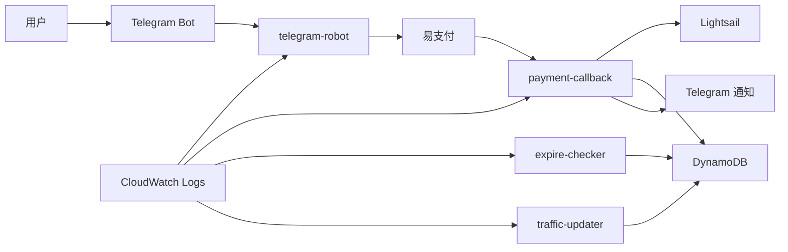

# Telegram Robot

基于 Telegram Bot + Lambda + Lightsail 的自动化实例交付系统。

用户通过 Telegram 下单后，支付成功后系统会自动创建 Lightsail 实例，并部署 Shadowsocks 2022 协议，最终将连接信息返回给用户。

---

## 1. 项目简介

本项目实现自动化 SaaS 流程，项目由多个独立的 Lambda 组件协同工作，分别负责：

- `telegram-robot/`：处理 Telegram 用户交互，生成支付订单
- `payment-callback/`：接收支付回调，创建 Lightsail 实例并部署服务
- `expire-checker/`：检查到期实例并进行销毁/通知
- `traffic-updater/`：周期性更新流量数据

---

## 2. 功能特性

- Telegram 下单与查询
- 易支付订单生成
- 支付成功后的自动回调处理
- Lightsail 实例自动创建
- Shadowsocks 2022 自动部署
- 节点连接信息自动回传
- 流量状态同步
- 到期实例自动检查与销毁
- Telegram 通知推送

---

## 3. 系统架构



---

## 4. 业务流程

1. 用户在 Telegram 中发送命令。
2. `telegram-robot` 接收消息并生成支付订单链接。
3. 用户完成支付后，易支付回调 `payment-callback`。
4. `payment-callback` 验证支付签名并确认订单状态。
5. 系统在 Lightsail 创建新实例。
6. 自动部署 Shadowsocks 2022。
7. 实例信息和连接参数写入 DynamoDB。
8. 通过 Telegram 返回节点连接信息给用户。
9. `traffic-updater` 定期同步流量信息。
10. `expire-checker` 定期检查实例到期状态，并在到期后进行销毁与通知。

---

## 5. 项目结构

```text
telegram-robot/
├── README.md
├── telegram-robot/
│   ├── lambda_function.py      # 入口，路由分发
│   ├── bot.py                  # Telegram 消息发送封装
│   ├── plans.py                # 套餐配置
│   ├── yipay.py                # 易支付生成支付链接封装
│   ├── handlers/
│   │   ├── __init__.py
│   │   ├── start.py            # /start 命令
│   │   ├── buy.py              # 购买流程
│   │   └── servers.py          # 查询服务器 / 流量
│   └── db/
│       ├── __init__.py
│       ├── orders.py           # DynamoDB orders 表操作
│       └── servers.py          # DynamoDB servers 表操作
│
├── payment-callback/
│   ├── lambda_function.py       # 入口，验签 + 路由
│   ├── yipay.py                # 易支付验签封装
│   ├── lightsail.py            # 创建实例 + 开端口 + 等待 IP
│   ├── userdata.py             # 生成 SS2022 User Data 脚本
│   ├── ss.py                   # 生成 ss:// 链接
│   ├── bot.py                  # Telegram 消息发送封装
│   ├── plans.py                # 套餐配置
│   ├── traffic_updater.py      # 采集流量写入 DynamoDB
│   └── db/
│       ├── __init__.py
│       ├── orders.py
│       └── servers.py
│
├── expire-checker/
│   ├── lambda_function.py      # 入口，扫描 + 提醒 + 销毁
│   ├── bot.py                  # Telegram 消息发送封装
│   └── db/
│       ├── __init__.py
│       └── servers.py
│
├── traffic-updater/
│   └── lambda_function.py      # 入口，采集流量 + 写入 DynamoDB
```

---

## 6. Lambda 组件说明

### 6.1 `telegram-robot`
负责处理 Telegram 用户消息和下单逻辑，主要功能包括：

- 处理 `/start`
- 处理购买流程
- 查询服务器状态
- 生成支付订单链接
- 通过 Telegram 通知用户

---

### 6.2 `payment-callback`
这是系统的关键 Lambda，负责：

- 验证易支付回调签名
- 更新订单状态
- 创建 Lightsail 实例
- 自动部署 Shadowsocks 2022
- 写入数据库
- 通过 Telegram 返回连接信息

---

### 6.3 `expire-checker`
用于检测到期实例，主要逻辑包括：

- 扫描到期实例
- 发送到期提醒
- 自动销毁实例
- 向用户发送状态通知

---

### 6.4 `traffic-updater`
用于定时采集 Lightsail 流量信息，并同步更新到 DynamoDB。

---

## 7. 资源说明

| 服务 | 用途 |
| :--- | :--- |
| AWS Lambda | 执行业务逻辑 |
| Amazon Lightsail | 创建和管理实例 |
| Amazon DynamoDB | 存储订单和服务器状态 |
| Amazon EventBridge | 定时触发任务 |
| Amazon CloudWatch Logs | 记录 Lambda 日志 |
| AWS IAM | 配置函数权限 |
| Telegram Bot API | 接收和发送 Telegram 消息 |

---

## 8. DynamoDB 数据表结构

下面是当前项目实际使用的 DynamoDB 数据结构，并附带模拟数据，方便在 README 中直接展示和理解。

### 8.1 `orders` 表

`orders` 表用于保存订单信息，核心字段如下：

| 字段名 | 类型 | 说明 | 模拟值 |
| :--- | :--- | :--- | :--- |
| `order_id` | String | 分区键，订单唯一 ID | `11f9d91fc8494b4498ff` |
| `created_at` | Number | 订单创建时间戳 | `1793131928` |
| `plan_key` | String | 套餐键 | `kr_5` |
| `status` | String | 订单状态 | `paid` |
| `user_id` | String | 用户 ID | `7496678656` |

示例数据：

```json
{
  "order_id": "11f9d91fc8494b4498ff",
  "created_at": 1793131928,
  "plan_key": "kr_5",
  "status": "paid",
  "user_id": "7496678656"
}
```

---

### 8.2 `servers` 表

`servers` 表用于保存已创建实例的连接信息和状态，字段如下：

| 字段名 | 类型 | 说明 | 模拟值 |
| :--- | :--- | :--- | :--- |
| `user_id` | String | 分区键，用户 ID | `7496678656` |
| `instance_name` | String | 排序键，实例名 | `ss-7496678656-11f9d91f` |
| `created_at` | Number | 实例创建时间戳 | `1793131972` |
| `expire_at` | Number | 到期时间戳 | `1795723972` |
| `ipv4` | String | IPv4 地址 | `3.36.111.242` |
| `ipv6` | String | IPv6 地址 | `2406:da12:af:1900:7f3a:fcb5:94b3` |
| `ls_region` | String | Lightsail 区域 | `ap-northeast-2` |
| `password` | String | Shadowsocks 密码 | `B+QUnQQpGH20Qg+3xDQ==` |
| `plan_key` | String | 套餐键 | `kr_5` |
| `plan_name` | String | 套餐名 | `首尔独享 36.99 / 1TB / 月` |
| `port` | Number | 代理端口 | `8388` |
| `region_name` | String | 区域名 | `韩国` |
| `ss_link` | String | IPv4 连接链接 | `ss://...` |
| `ss_link_v6` | String | IPv6 连接链接 | `ss://...` |
| `traffic_bytes` | Number | 流量使用量（字节） | `103070823` |

示例数据：

```json
{
  "user_id": "7496678656",
  "instance_name": "ss-7496678656-11f9d91f",
  "created_at": 1793131972,
  "expire_at": 1795723972,
  "ipv4": "3.36.111.242",
  "ipv6": "2406:da12:af:1900:7f3a:fcb5:94b3",
  "ls_region": "ap-northeast-2",
  "password": "B+QUnQQpGH20Qg+3xDQ==",
  "plan_key": "kr_5",
  "plan_name": "首尔独享 36.99 / 1TB / 月",
  "port": 8388,
  "region_name": "韩国",
  "ss_link": "ss://MjA1MDQ0MDY0MjY4NDA2NzQzN0A6MTA2Ljc4LjE0MC4xNDo4Mzg4@3.36.111.242:8388#韩国",
  "ss_link_v6": "ss://MjA1MDQ0MDY0MjY4NDA2NzQzN0A6MTA2Ljc4LjE0MC4xNDo4Mzg4@2406:da12:af:1900:7f3a:fcb5:94b3:8388#韩国-IPv6",
  "traffic_bytes": 103070823
}
```

> 说明：上面的示例值是模拟数据，用于 README 展示，实际生产中可能因用户和实例而不同。

---

## 9. 运行环境

| 配置项 | 值 |
| :--- | :--- |
| Python 版本 | 3.12 |
| 部署区域 | 可按区域选择，默认可用 Tokyo；香港存在部分限制 |
| Lambda 内存 | 256 MB |
| 支付平台 | 易支付 |
| 代理协议 | Shadowsocks 2022 |
| 加密方式 | `2022-blake3-aes-128-gcm` |

> 说明：这个项目不是固定绑定到 `ap-northeast-1`，可根据 Lightsail 可用区和业务需求部署到不同区域；当前只有香港区域存在部分限制，需要按实际 Lightsail 可用性和区域支持来调整。

---

## 10. Lambda 环境变量说明（按实际代码）

本项目的 Lambda 配置不是统一的 `.env` 文件，而是按函数分别配置在 Lambda 的 Environment Variables 中。根据当前实现，环境变量如下：

| Lambda | 变量名 | 说明 |
| :--- | :--- | :--- |
| `telegram-robot` | `BOT_TOKEN` | Telegram Bot Token |
| `telegram-robot` | `BOT_USERNAME` | Bot 用户名 |
| `telegram-robot` | `NOTIFY_URL` | Telegram/支付回调通知地址 |
| `telegram-robot` | `YIPAY_KEY` | 易支付密钥 |
| `telegram-robot` | `YIPAY_PID` | 易支付商户 PID |
| `payment-callback` | `BOT_TOKEN` | Telegram Bot Token |
| `payment-callback` | `YIPAY_KEY` | 易支付验签密钥 |
| `expire-checker` | `BOT_TOKEN` | Telegram Bot Token |
| `traffic-updater` | 无 | 当前实现不依赖环境变量 |

> 注意：这里的变量名是按当前项目实际部署方式整理的，不是通用模板，也不使用本地 `.env` 方案。

示例配置：

```bash
aws lambda update-function-configuration \
  --function-name telegram-robot \
  --environment "Variables={BOT_TOKEN=your_bot_token,BOT_USERNAME=your_bot_username,NOTIFY_URL=https://your-api-id.execute-api.your-region.amazonaws.com/default/payment-callback,YIPAY_KEY=your_yi_pay_key,YIPAY_PID=your_yi_pay_pid}"

aws lambda update-function-configuration \
  --function-name payment-callback \
  --environment "Variables={BOT_TOKEN=your_bot_token,YIPAY_KEY=your_yi_pay_key}"

aws lambda update-function-configuration \
  --function-name expire-checker \
  --environment "Variables={BOT_TOKEN=your_bot_token}"
```

---

## 11. 部署步骤

### 11.1 创建 AWS 资源

需要提前准备以下资源：

- DynamoDB 表：`orders`
- DynamoDB 表：`servers`
- Lambda 函数
- IAM 角色
- EventBridge 定时任务
- CloudWatch Logs

---

### 11.2 打包并部署 Lambda

每个目录都是独立的 Lambda 代码包，示例：

```bash
cd telegram-robot
zip -r telegram-robot.zip .
```

然后上传到 Lambda 控制台，或通过 CLI 部署。

同理：

- `payment-callback/`
- `expire-checker/`
- `traffic-updater/`

都需要分别部署为独立的 Lambda 函数。

---

### 11.3 配置 Telegram Webhook

如果使用 Telegram Webhook，需要绑定回调地址：

```bash
curl -X POST "https://api.telegram.org/bot$BOT_TOKEN/setWebhook?url=https://your-api-id.execute-api.your-region.amazonaws.com/webhook"
```

这里的 `url` 必须是一个公网可访问的 HTTPS 地址，通常会绑定到 API Gateway 的接口地址，然后再转发到 `telegram-robot` Lambda。

实际部署时，通常需要保证：

- API Gateway 已经配置好 HTTPS 入口
- `/webhook` 路径和 Lambda 的处理逻辑一致
- `telegram-robot` Lambda 已经配置好 `BOT_TOKEN`
- Telegram 的 Bot 能正常访问该地址

如果想确认当前 Webhook 是否已经成功绑定，可以使用：

```bash
curl "https://api.telegram.org/bot$BOT_TOKEN/getWebhookInfo"
```

如果需要清除旧的 Webhook，可以执行：

```bash
curl "https://api.telegram.org/bot$BOT_TOKEN/deleteWebhook"
```

> 说明：Webhook 地址必须是稳定且可公开访问的入口，否则 Telegram 发送的消息可能无法正常回调到 Lambda。

---

### 11.4 配置支付回调

在易支付后台中配置回调地址时，请填写下面这个地址，并确保它与 Lambda 的 `NOTIFY_URL` 环境变量完全一致，如下示例：：

```bash
https://your-api-id.execute-api.your-region.amazonaws.com/default/payment-callback
```

回调处理流程通常包括：

- 校验签名
- 校验订单状态
- 更新订单为已支付
- 创建 Lightsail 实例
- 自动部署 Shadowsocks 2022
- 通过 Telegram 通知用户并返回连接信息

> 注意：回调地址必须是公网可访问的 HTTPS 地址，并且需要与 API Gateway 或 Lambda 的实际接口路径一致，否则易支付回调可能无法正确进入 `payment-callback`。

---

### 11.5 配置定时任务

通过 EventBridge 配置两类定时任务：

- `expire-checker`：定时扫描到期实例
- `traffic-updater`：每 6 小时执行一次流量同步

---

## 12. 常见问题

### 1. 支付成功后没有创建实例
常见原因：

- 回调地址配置错误
- 签名校验失败
- IAM 权限不足
- Lambda 环境变量缺失
- Lightsail 参数配置错误

### 2. Telegram 没有收到消息
检查项：

- Bot Token 是否正确
- Webhook 是否已绑定
- Lambda 是否正常执行
- API 转发是否成功

### 3. 实例创建成功但服务未启动
检查项：

- User Data 脚本是否执行成功
- Shadowsocks 2022 安装命令是否正常
- 安全组和端口是否放行
- 实例日志中是否存在异常

---

## 13. 未来规划

- [ ] 网页版后台管理（开发中）
- [x] 多地区实例支持（已完成）
- [ ] 流量超限提醒（开发中）
- [x] 更完善的订单状态管理（与网页版后台管理同步上线）
- [x] 更细粒度的监控与告警（与网页版后台管理同步上线）
- [ ] 支持更多代理协议和实例模板（团队商议中）

---

## 14. 说明

这个项目不是单一 Lambda 代码，而是多个 Lambda 包组合工程。它的配置方式是 AWS Lambda Environment Variables，并通过 EventBridge / Webhook / 回调机制协同工作。

适用场景包括：

- Telegram Bot 售卖服务
- 自动化云主机开通交付
- 自动化代理节点部署

---

## 15. 总结

本项目的核心价值在于：把 Telegram 交互、支付回调、Lightsail 实例创建和自动部署串联起来，形成一条完整的云服务自动化交付链路，它适合用于小型 SaaS / 云服务自动化场景。
